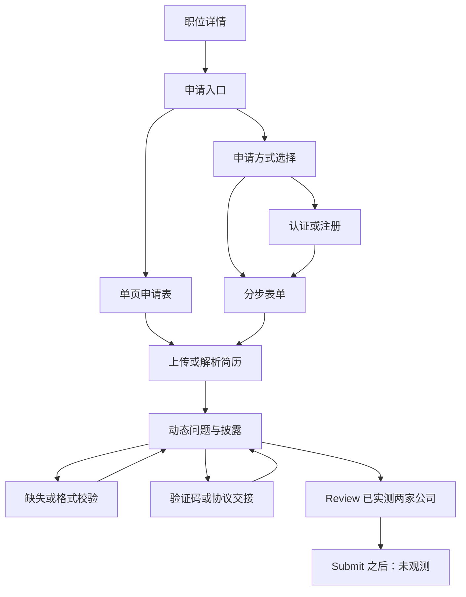

# 可复用的申请流程模式

依据 2026-10-11 的 12 家真实浏览器样本；这里只描述到达过的状态。完整公司差异见 [比较](ats-comparison.md)，具体字段与截图见 companies/。

## 通用状态机

这些是可组合状态，不能强制每个 ATS 都走完整图。例如 Greenhouse、Ashby、Lever 的样本没有观察到独立 Review，而 Workday 有明确 Review 步骤。

## Workday：方法选择、可选认证、五步向导

三家公司均实际观察到 Autofill with Resume / Apply Manually / Use My Last Application。只深入 Manual；另外两条不能标记已覆盖。NVIDIA/Salesforce 需认证，Adobe Manual 直接访客填写。注册前六步和注册后五步需按当前可见进度重新计算，不能硬编码认证永远是第 1/6 步。

登录后的顺序一致：My Information → My Experience → Application Questions → Voluntary Disclosures → Review。Adobe 的按钮是 Next，NVIDIA/Salesforce 是 Save and Continue；Back 在后续步骤存在。页面 URL 可以一直是 applyManually，路径不变不代表没有跨步骤。以 heading、current step、分区和按钮改变判定转换，等待异步保存完成后重读。

实测 Review：Adobe、Salesforce。Review 展示姓名/地址/附件/问题/披露的只读复核，空白可显示 No Response，末尾 Back 和 Submit。没有执行最终 Submit，因而没有成功页、候选人门户状态、邮件、申请 ID 或重复申请行为的证据。

## Greenhouse：职位和长表单、可选账户、内嵌分支

Anthropic/Figma 是托管职位页，申请按钮进入或滚动到长表单。Airbnb 是公司页面 Application 页签内的 grnhse_iframe。三家手填均无强制登录；Figma 的 Autofill my application 另开 MyGreenhouse 登录（Email→security code，或社交方式），这是可选分支。

基础资料 → 附件 → 公司问题 → EEO → Submit application 是这批单页结构。不要把滚动位置视为向导步骤。空表单验证是行内错误与焦点恢复，必须在 frame 内读取 Airbnb 的错误。看见背景 reCAPTCHA iframe 不等于正在阻断用户。

## Ashby：概览/申请页签、可选解析、异步校验

三家都有 Overview/Application，Notion 还实际点击 Apply for this Job 链接进入。申请表可能先显示 Fetching application form。顶部 Autofill from resume 与字段中的 Resume 上传不可混为同一步。

Notion 上传合成 TXT 后 Parsing your resume → Autofilling key fields → 表单回填，Phone 仍空。后续不完整验证暂时禁用控件，再出现 Your form needs corrections 汇总；错误条目本身是按钮。自动填写器必须分别等待渲染、上传、解析、校验的完成状态。

Ramp 的 encoded secret 和安全解释是公司岗位问题；OpenAI 有申请次数提示、日历和仲裁/本人声明；Notion 有 Anchor Days/来源多选。通用单页导航可复用，公司问题不可用统一常量答案。

## Lever：详情 /apply、原生校验、验证码与解析

三家职位详情到 /apply 的链接已亲自点击。基础字段与公司补充问题在同一长页。学校/来源/EEO 可用原生 SELECT，布尔题又可用 radios，来源/代词可为真多选。

Veeva 名字空白时先被浏览器原生 required 校验拦住，未观察 hCaptcha；Palantir/Zoox 不完整提交则先出现 hCaptcha。用户完成后验证码消失、返回原表单，不能直接将这一状态归类为业务验证通过。最后继续一次验证时两家都再次出现图片挑战。验证码令牌/后端错误与最终业务提交状态未知。

Veeva 上传同一 TXT 实际 Analyzing resume → Success!，回填姓名/邮箱/电话/公司；附件并非本岗位必填。不应把“附件上传成功”“解析完成”“申请提交成功”合并为一个 success。

## 对 auto-apply 的可复用处理建议（根据观察推导，未实现）

1. 以 heading、progress current step、表单题块、按钮集合和错误状态构成页面签名；保留 URL 与 frame 路径，但不只靠 URL。
2. 每次变更国家、前雇员身份、多选、附件等后重新枚举可见字段；记录新增、移除、required 和可访问名称的差异。
3. 重复教育/工作按组定位 Add/Delete，再采集新组的输入；不要使用全页第 n 个按钮或动态 ID 常量。
4. 将可见必填标记、DOM required/aria-required、实际错误分开存；缺少原生 required 不表示可留空。
5. 解析后比对字段变化和空缺，再填写；对未知字段保留人工内容需求。
6. 在正式 Submit 前保留复核/人工批准门；单页系统可由本地构建复核视图，但不得宣称该站本身有 Review。
7. 验证码/协议/敏感资料分别作为明确交接状态，恢复后重新观察，避免重复提交。
